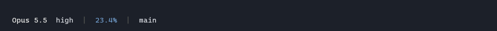

# claude-statusline

[](https://github.com/lucaslobasso/claude-statusline/actions/workflows/ci.yml)
[](CHANGELOG.md)
[](LICENSE)
[](#requirements)
[](#install)

<p align="center">
  
</p>

A Claude Code status line with no config file to write. Left: model, effort, context used, git branch. Right: your weekly and 5-hour usage with the time until each resets, **shown only once it passes 50%**, in yellow, then orange, then bold red. Installed as a plugin, so setup is one command and the look is chosen in `/config`.

> Unofficial community project, not affiliated with Anthropic.

**[Requirements](#requirements) · [Install](#install) · [Settings](#settings) · [How it looks](#how-it-looks) · [Update](#update) · [How it works](#how-it-works) · [Troubleshooting](#troubleshooting) · [Uninstall](#uninstall) · [Install the whole set](#install-the-whole-set)**

## Requirements

- Claude Code **2.1.3xx or newer** (`claude --version`), which has the function-hook plugin API (early access; it may change between releases).
- **Node.js 18+** on your `PATH` (the status line is a small Node script with no dependencies). `git` for the branch.
- Usage numbers need a Claude subscription (Pro or Max); with API billing the right side stays empty.

## Install

In a Claude Code session:

```
/plugin install statusline --marketplace lucaslobasso/claude-statusline
```

Or from a shell:

```sh
claude plugin marketplace add lucaslobasso/claude-statusline
claude plugin install statusline@claude-statusline --scope user
```

The status line appears from the next session on. If your `settings.json` already has a different status line, the plugin leaves it alone and tells you; remove it and run `/claude-statusline on`.

## Settings

Change them in `/config` under **statusline**, or at install time with `--config key=value`:

| Setting | Default | Values | What it does |
| --- | --- | --- | --- |
| `enabled` | `true` | true / false | Keep this status line set. Off removes it from `settings.json` |
| `usageFrom` | `50` | 0 to 100 | Usage stays hidden below this percent, then shows in yellow. `0` = always shown |
| `orangeFrom` | `75` | 0 to 100 | Usage turns orange from here |
| `redFrom` | `90` | 0 to 100 | Usage turns bold red from here |
| `showEffort` | `true` | true / false | Effort level next to the model |
| `showContext` | `true` | true / false | Percent of the context window used |
| `showBranch` | `true` | true / false | Current git branch (or `⎇ no git`) |
| `showResets` | `true` | true / false | Time until each usage window resets |

Weekly and 5-hour usage are colored on their own, each by its own percent.

| Command | What it does |
| --- | --- |
| `/claude-statusline status` | Whether it is on, and the settings that differ from the defaults |
| `/claude-statusline off` | Removes it from `settings.json` (and sets `enabled` to false) |
| `/claude-statusline on` | Puts it back |

## How it looks

**A real session** (top of this page): usage at 62% shows in yellow.

| Setting / usage | Status line |
| --- | --- |
| Below 50%: hidden |  |
| 50–74%: yellow |  |
| 75–89%: orange (weekly still yellow) |  |
| 90%+: bold red |  |
| `usageFrom=0`: always shown |  |
| `showEffort`, `showContext`, `showResets` off |  |

<sub>The top picture is a real Claude Code session captured offscreen. The rows are the real `statusline.mjs` fed made-up usage numbers (`docs/demo.mjs`), so every step can be shown.</sub>

## Update

```sh
claude plugin marketplace update claude-statusline
claude plugin update statusline@claude-statusline
```

Each update moves the script to a new folder; the plugin points `settings.json` at it on the next session start. See [CHANGELOG.md](CHANGELOG.md).

## How it works

Claude Code reads the status line only from `settings.json`, so the plugin keeps a `statusLine` entry there (`node ".../statusline.mjs" [flags]`). It edits only that entry and keeps the rest of the file as it was. It only ever changes an entry that is its own: this plugin's script, the copy the old `install.ps1` made (`~/.claude/statusline/statusline.mjs`), or boxed-messages 1.x's built-in status line, which it replaces.

Claude Code runs the script every few seconds with the session's status as JSON on stdin. Each session only knows its own last usage reading, so readings from all sessions are merged in `~/.claude/statusline/usage.json` (newest window first, then the highest percent). A fresh session shows usage before its first reading. Settings reach the script as flags such as `--usage-from=60 --no-branch`.

## Troubleshooting

- **No status line.** Start a new session, then run `/claude-statusline status`. A notice about "another status line" means your `settings.json` already had one; remove it and run `/claude-statusline on`.
- **"node" is not recognized / an empty bar.** Install Node.js 18+ and make sure `node` runs in a new terminal.
- **No usage on the right.** It is hidden below `usageFrom` (50% by default). Set `usageFrom` to `0` to always show it. With API billing there are no usage windows.
- **`claude agents` (agent view) shows no status line.** Agent view doesn't run status lines or plugin UI, so usage can't be shown there. [Claude Taskbar](https://github.com/lucaslobasso/claude-taskbar) shows it on the Windows taskbar instead.
- **Coming from the old `install.ps1` version.** Install the plugin; it takes over the old entry. You can delete `~/.claude/statusline/statusline.mjs` afterwards (keep `usage.json`).

## Uninstall

Plugins get no uninstall hook, so remove the entry first:

```
/claude-statusline off
```

Then:

```sh
claude plugin uninstall statusline@claude-statusline
claude plugin marketplace remove claude-statusline
```

If you uninstalled first, delete the `statusLine` block from `~/.claude/settings.json` by hand. `~/.claude/statusline/usage.json` can go too.

<!-- bundle:start (copied from claude-launcher/docs/bundle-section.md; edit it there and copy to all six READMEs) -->
## Install the whole set

This is one of six small tools that work well together. Each installs on its own, or get them all with one command:

| Tool | What it does | Runs on |
| --- | --- | --- |
| [Claude Launcher](https://github.com/lucaslobasso/claude-launcher) | One click from the taskbar or Start menu straight into Claude Code, with a Claude icon and a loading spinner | Windows |
| [Claude Taskbar](https://github.com/lucaslobasso/claude-taskbar) | Your Claude sessions and usage limits as dots and bars on the Windows taskbar | Windows |
| [boxed-messages](https://github.com/lucaslobasso/claude-boxed-messages) | Colored boxes around your prompts and Claude's replies | Any |
| [claude-statusline](https://github.com/lucaslobasso/claude-statusline) | A status line with model, context, branch, and usage only when it gets high | Any |
| [limit-revive](https://github.com/lucaslobasso/claude-limit-revive) | Resumes an unfinished session after the usage limit resets | Any |
| [language-spinner](https://github.com/lucaslobasso/claude-language-spinner) | The "thinking" spinner shows words in a language you are learning | Any |

**Windows** (PowerShell 7):

```powershell
irm https://raw.githubusercontent.com/lucaslobasso/claude-launcher/main/bundle.ps1 | iex
```

To pick, pass options: `-Only statusline,limit-revive`, `-Skip launcher`, `-List` (show what is installed) or `-Uninstall`:

```powershell
& ([scriptblock]::Create((irm https://raw.githubusercontent.com/lucaslobasso/claude-launcher/main/bundle.ps1))) -Skip taskbar
```

**macOS and Linux:** the four plugins work everywhere. In a shell:

```sh
for p in boxed-messages statusline limit-revive language-spinner; do
  claude plugin marketplace add "lucaslobasso/claude-$p"
  claude plugin install "$p@claude-$p" --scope user
done
```
<!-- bundle:end -->

## Contributing

```sh
git clone https://github.com/lucaslobasso/claude-statusline
cd claude-statusline
claude --plugin-dir .            # try it in a session
node --test test/                # status line tests
claude plugin test .             # plugin tests (settings.json handling)
claude plugin validate .
```

- Try the script alone: `echo '{"rate_limits":{"five_hour":{"used_percentage":80,"resets_at":9999999999}}}' | node statusline.mjs --usage-from=0` (set `CLAUDE_CONFIG_DIR` to a temp folder so the usage snapshot stays out of your real one).
- `python docs/screenshots.py` retakes the pictures offscreen (needs `pip install pyte pillow pywinpty`).

## License

[MIT](LICENSE) © Lucas Lobasso
